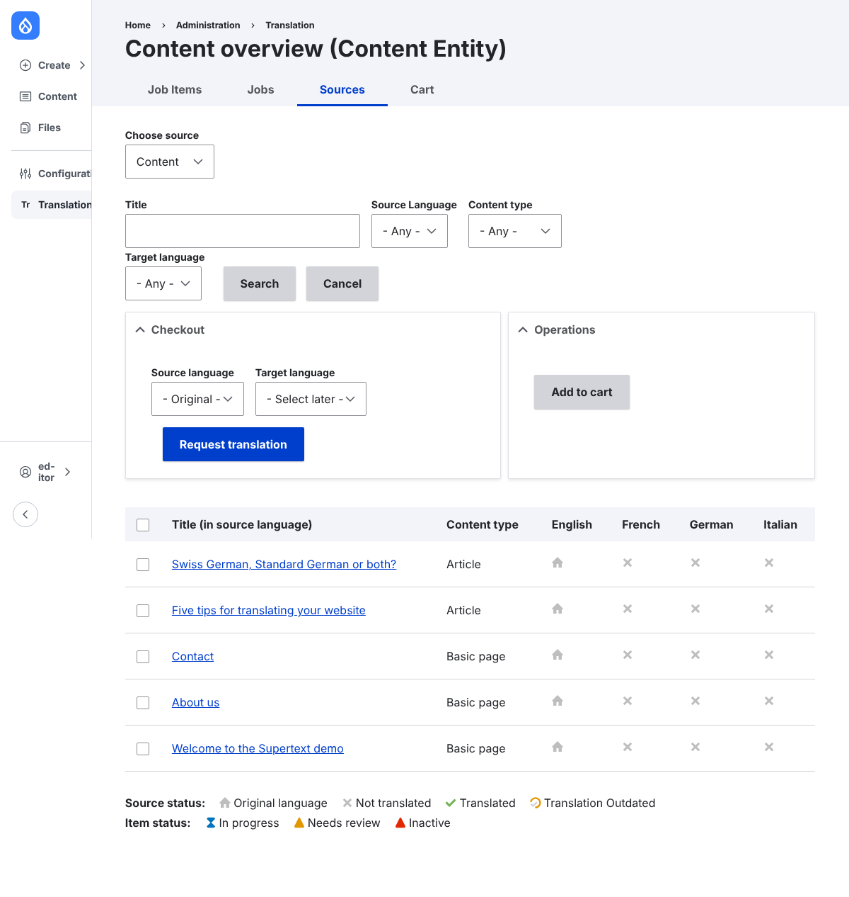

# Drupal demo for Supertext AI translation

A ready-to-use Drupal 11 site with the [Translation Management Tool (TMGMT)](https://www.drupal.org/project/tmgmt)
and the **Supertext AI translator** ([tmgmt_supertext_ai](https://www.drupal.org/project/tmgmt_supertext_ai)),
so you can try Supertext AI translation in Drupal without setting anything up.

The translator module itself is released on drupal.org and maintained by
[MD Systems](https://www.md-systems.ch); this repository only holds the **demo site** that
installs it. It runs on Railway and redeploys on every push to `main`.

## What's in the demo

- Drupal 11 with English (default), German, French and Italian, content translation on for
  pages and articles
- TMGMT with the Supertext AI translator, mapped to Swiss German, French and Italian
  (`de-CH`, `fr-CH`, `it-CH`)
- Five English pages and articles to translate
- An administrator and an editor account, created from the hosting platform's variables

## Guides

| Guide | For |
| --- | --- |
| [Installation guide](docs/INSTALLATION.md) | Administrators: installing the module on your own Drupal site, API key, languages, settings |
| [User guide](docs/USER_GUIDE.md) | Editors: translating content with Supertext in Drupal |
| [Developer guide](docs/DEVELOPER.md) | Developers: how the demo image works, variables, Railway, checks |

No Supertext account yet? Create one at [supertext.com](https://www.supertext.com/person/en/account/signin).
Generate your API key at [supertext.com → Integrations → API](https://www.supertext.com/en/integrations/api) (requires the Admin role).

## Support

Questions about Supertext: [support@supertext.com](mailto:support@supertext.com) or the
[support form](https://integrations.supertext.com/support). Problems with the module itself:
the [tmgmt_supertext_ai issue queue](https://www.drupal.org/project/issues/tmgmt_supertext_ai).

## License

GPL-2.0-or-later, like Drupal. See [LICENSE](LICENSE).
