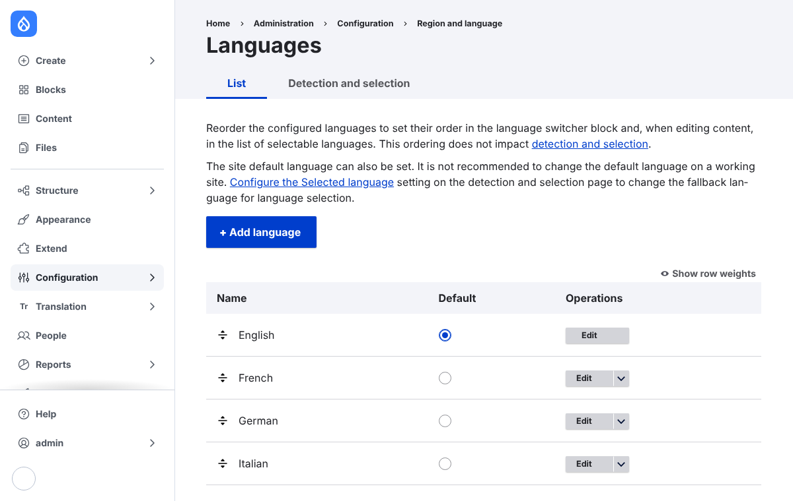
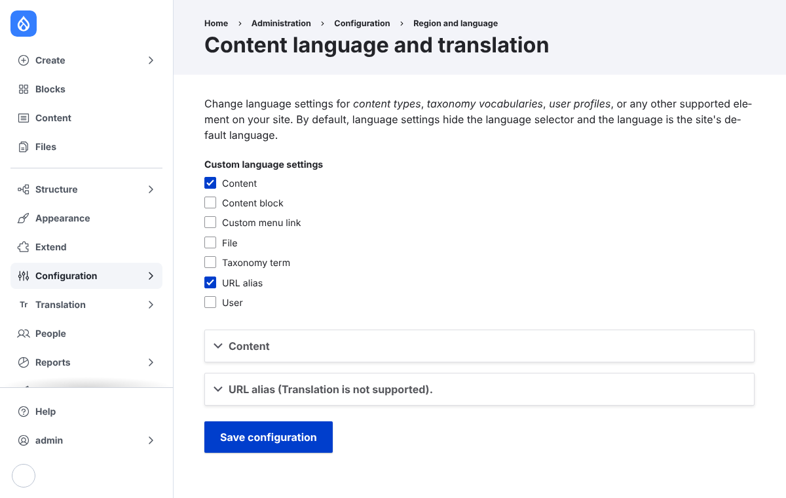
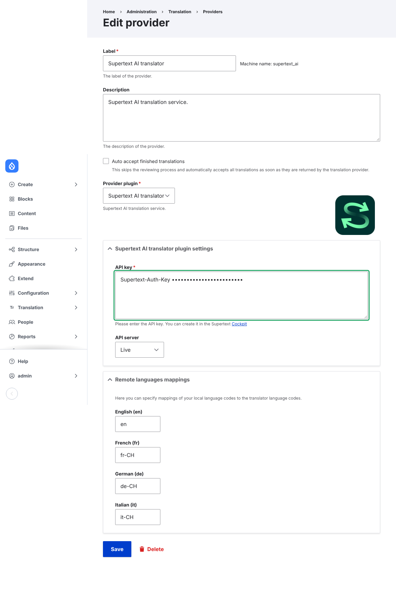

# Installation guide

How to add Supertext AI translation to your own Drupal site. The demo in this repository
is set up exactly like this (see the [developer guide](DEVELOPER.md) for the automated
version).

## Requirements

- Drupal 10.3 or 11
- The core modules **Language** and **Content Translation**
- [TMGMT](https://www.drupal.org/project/tmgmt) 1.x with its **Content Entity Source**
  (`tmgmt_content`)
- A Supertext account with an AI API key

No Supertext account yet? Create one at supertext.com:
https://www.supertext.com/person/en/account/signin
Generate your API key at supertext.com → Integrations → API (requires the Admin role):
https://www.supertext.com/en/integrations/api

## Install

```sh
composer require drupal/tmgmt drupal/tmgmt_supertext_ai
drush pm:install language content_translation tmgmt tmgmt_content tmgmt_supertext_ai
```

Or in the admin: **Extend**, tick *Content Translation*, *Translation Management Core*,
*Content Entity Source* and *TMGMT Translator Supertext AI*, then **Install**.

**Update:** `composer update drupal/tmgmt_supertext_ai`, then `drush updatedb`.
**Uninstall:** `drush pm:uninstall tmgmt_supertext_ai` (delete the Supertext provider first
if Drupal asks), then `composer remove drupal/tmgmt_supertext_ai`.

## Languages

1. **Configuration → Regional and language → Languages**: add every language you translate
   into. The demo has English (default), German, French and Italian.

   

2. **Configuration → Regional and language → Content language and translation**: tick the
   content types to translate (the demo: *Basic page* and *Article*) and their fields.

   

## The Supertext provider

**Translation → Providers → Supertext AI translator → Edit** (installing the module creates
it):



| Setting | What to enter |
| --- | --- |
| API key | Your Supertext AI API key (with or without the `Supertext-Auth-Key ` prefix shown on supertext.com) |
| API server | *Live* (other servers are for Supertext's own testing) |
| Auto accept finished translations | Off: translations wait for an editor's review. On: they are saved to the content right away |
| Remote languages mappings | The Supertext language for each Drupal language, **with a region for target languages**: `de-CH` or `de-DE`, `fr-CH` or `fr-FR`, `it-CH` or `it-IT`. Keep the source language bare (`en`) |

Supertext rejects a bare target code such as `de` (*INVALID_LANGUAGE_PAIR*), and TMGMT
fills the mappings with the bare Drupal codes by default, so set them before the first
job.

## Permissions

Editors who translate need, besides editing the content type:
*Create/Update content translations*, *Translate any entity*, *Create translation jobs*,
*Submit translation jobs*, *Accept translation jobs* and *Access the sources overview*.
The demo grants them to the *Content editor* role.

## Troubleshooting

| Problem | What to do |
| --- | --- |
| The provider shows *not available* | No API key entered: edit the provider and add it |
| Job rejected with *INVALID_LANGUAGE_PAIR* | The target language mapping has no region: set e.g. `de-CH` instead of `de` |
| *Authentication failed* (401/403) | The key is wrong or was revoked: generate a new one at supertext.com → Integrations → API (requires the Admin role) |
| *Too many requests* (429) | Many languages at once: wait a minute and submit the remaining jobs again |
| A language is missing in the sources overview | It isn't added under *Languages*, or the content type isn't translatable |
