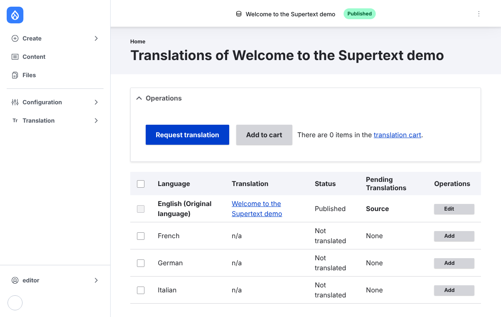
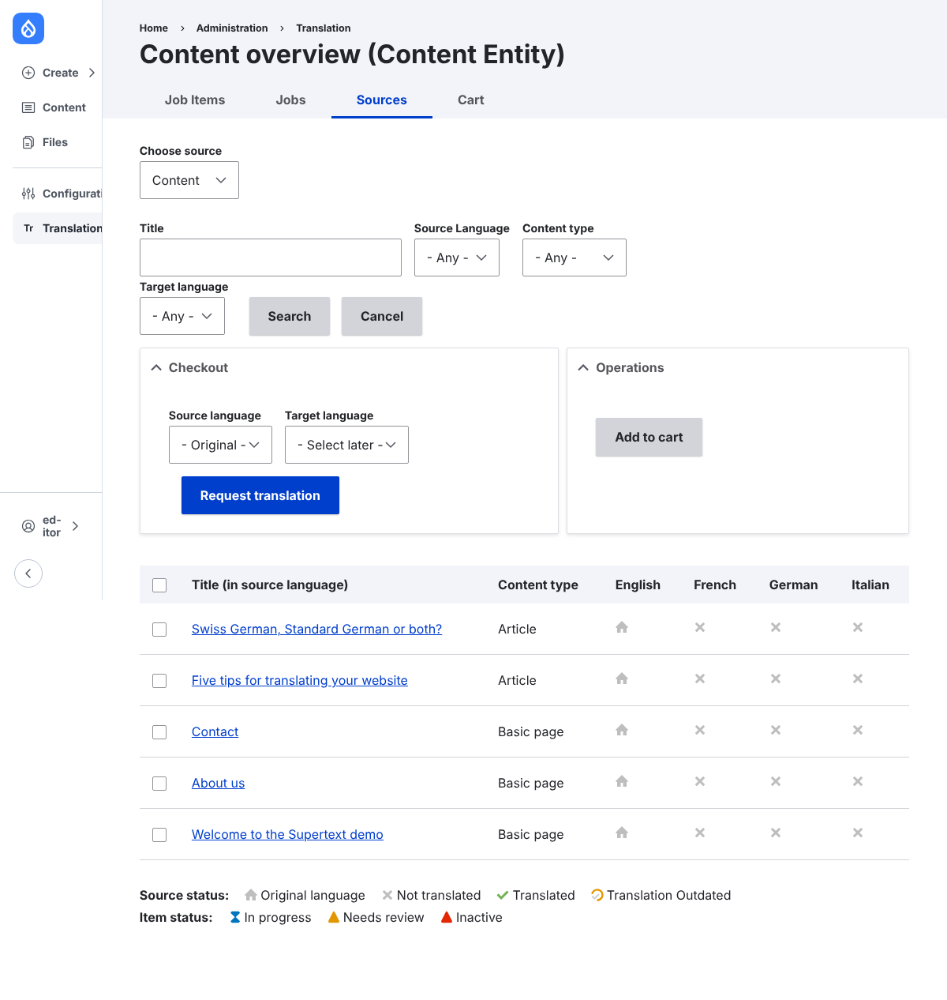
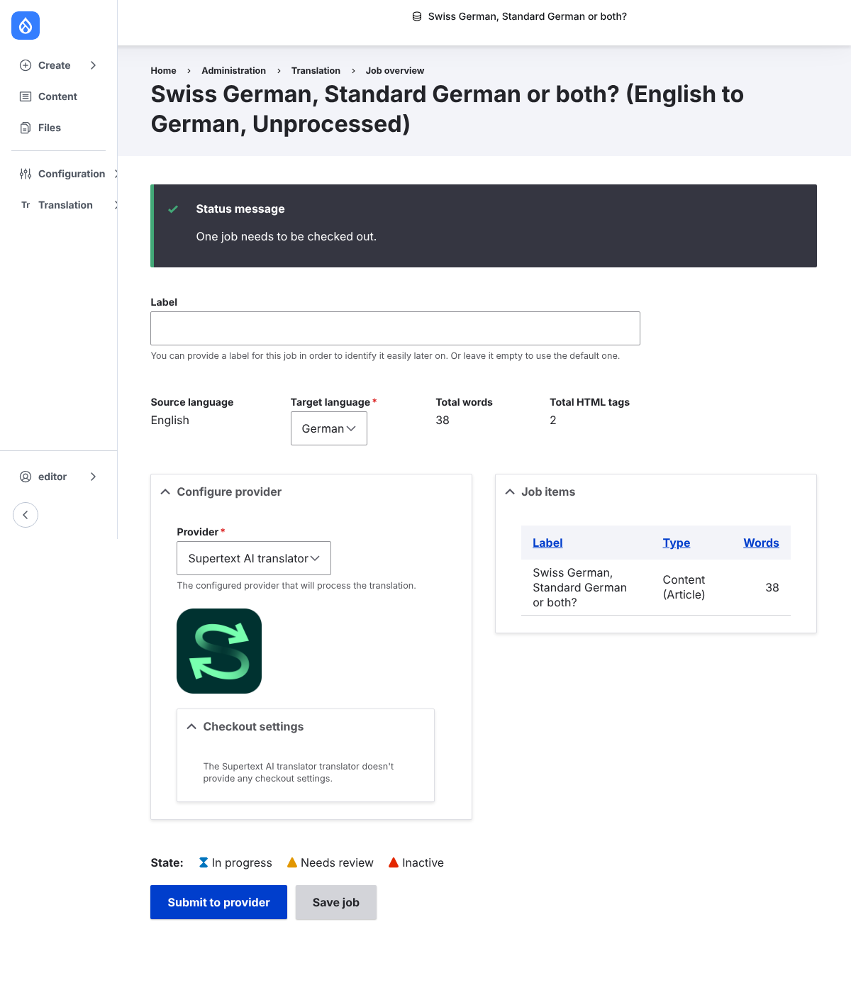

# User guide

How editors translate content with Supertext in Drupal. In the demo, log in with the
editor account.

## Translate one page

1. Open the page and choose the **Translate** tab. It lists every language and whether a
   translation exists.

   

2. Tick the languages you want and choose **Request translation**.
3. On the job page, check that **Provider** is *Supertext AI translator* and choose
   **Submit to provider**. Supertext translates the job within seconds.
4. Open the job item, check the translation and choose **Save as completed**: the
   translation is saved to the page in that language. (If the administrator turned on
   *Auto accept*, this step is skipped.)

## Translate several pages at once

**Translation → Sources** lists all translatable content with a column per language.

1. Filter by title, content type or language if you like.
2. Tick the pages, choose a **Target language** (or *Select later*) and **Request
   translation**: one job per target language.
3. Submit each job to the *Supertext AI translator*.

Jobs and their state are under **Translation → Jobs**.

## What is translated

All translatable fields of the content: title, body and other text fields, with their
formatting (bold, links, lists). Fields that aren't marked translatable by the
administrator stay as they are. Images and files are not translated.

## Updating a translation

Translate the page again after changing the original: TMGMT creates a new job and the
accepted translation replaces the old one in that language. Edits you made by hand in the
translation are overwritten, so make them again afterwards or edit the translation only.

## Error messages

| Message | Meaning |
| --- | --- |
| *Provider not available* | The Supertext API key is missing: ask your administrator |
| *INVALID_LANGUAGE_PAIR* | Supertext doesn't accept that target language code: the administrator needs to set a regional code (e.g. `de-CH`) |
| *Authentication failed* | The API key is wrong or revoked: ask your administrator |
| *Too many requests* | Many jobs at once: wait a minute and submit again |
